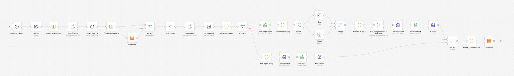
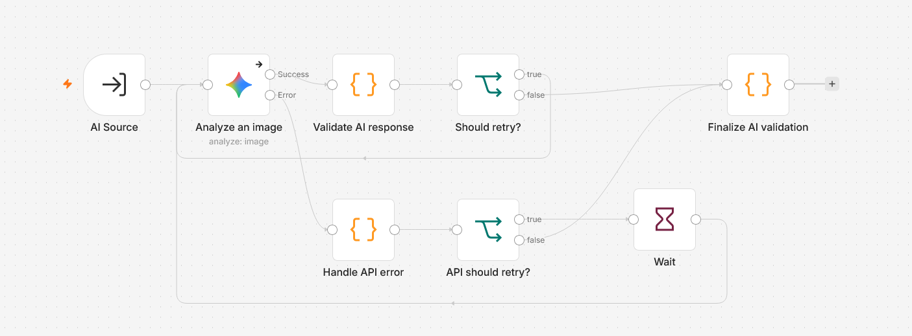

# Image check - Ai 🔍🖨️

**Experimental DTP Preflight & AI-Assisted Raster Image Quality Inspection with n8n and Google Gemini**

    

## Overview

**Image check - Ai** is an experimental automation project for **DTP operators, print production teams, and prepress professionals**. It combines deterministic checks of raster image metadata with a visual quality assessment performed by a general-purpose multimodal AI model.

The automation monitors folders containing print jobs, reads each job's `spec.json`, checks the technical parameters of its JPEG/PNG images, prepares selected image samples for Gemini, and saves an individual JSON report for every inspected file. It also records processing status in an n8n Data Table so completed jobs are not intentionally processed again on the next scan.

**This is both a working automation and a practical experiment:** can widely available multimodal AI models reliably identify image defects that are difficult to detect from metadata alone—especially **upscaling, interpolation, JPEG compression artifacts, loss of fine detail, and artificial sharpening**?

The project was built to investigate that question, not to claim that AI can replace an experienced prepress operator. In testing, Gemini sometimes assigned relatively high quality scores to images that had been substantially enlarged and recompressed. This is a useful finding in itself: **a valid AI response is not necessarily an accurate technical assessment**.

**Perfect for:** Exploring AI-assisted DTP quality control, prototyping prepress workflows, inspecting incoming raster files, and learning how to connect n8n, local image processing, and multimodal models.

---

## ✨ Key Features

### Automated Job Detection
- **Folder-based workflow:** Each print job has its own directory containing image files and a `spec.json` specification.
- **Ready signal:** A job is eligible for processing only after `spec.json` is present. For reliable operation, create or copy this file **after all images have finished uploading**.
- **Multiple files per job:** A specification can reference one or more JPEG/PNG files.
- **Job tracking:** An n8n Data Table records `PROCESSING`, `COMPLETED`, and error states, helping prevent repeated analysis.

### Deterministic Technical Preflight
- **Print dimensions:** Checks trimmed dimensions with bleed included.
- **Effective resolution:** Calculates effective PPI from pixel dimensions and required print size.
- **Whole-pixel rounding:** Accounts for the rounding needed when converting millimetres and PPI to integer pixel dimensions.
- **Aspect ratio:** Checks whether image proportions match the required dimensions, using a configurable tolerance (0.5% in this version).
- **Orientation:** Verifies portrait/landscape orientation.
- **Clear rejection reasons:** A failed metadata check produces a report without unnecessarily calling Gemini.

### AI-Assisted Visual Quality Inspection
- **Three 1:1 crops:** Examines up to three 768 × 768 px regions without enlarging or shrinking the cropped pixels.
- **Full-image preview:** Also supplies a reduced overview, with the longest side limited to 768 px, for visual context.
- **16 quality criteria:** Inspects sharpness, blur, pixelation, compression artifacts, suspected upscaling, noise, smoothing, sharpening, banding, aliasing, moiré, clipping, color artifacts, AI artifacts, fine-detail legibility, and visual consistency.
- **Structured response validation:** Checks Gemini's JSON syntax and required fields before accepting its output.
- **Retries and error handling:** Handles malformed responses and temporary API failures, rather than treating failed requests as valid inspections.

### Reporting and Traceability
- **One report per image:** Technical checks and AI findings are saved together as JSON.
- **Technical FAIL is still documented:** Files that fail metadata checks receive reports with AI analysis marked as skipped.
- **Completion check:** A job is marked `COMPLETED` only after the required reports have been accounted for and the analyses have completed successfully.
- **Independent data:** Output reports can be consumed by another system later, without requiring a separate reporting database.

---

## 🧩 Project Architecture — Two n8n Workflows

The automation consists of **two separate n8n workflows**. **Both must be imported** for the complete process to work.

### 1. Main Workflow — Image Check



*Screenshot: complete main n8n workflow (add `screenshots/main-workflow.png`).*

The main workflow manages files, technical validation, report generation, and job tracking.

**Processing sequence:**

1. **Discover jobs:** A scheduled scan locates job directories with a `spec.json` file.
2. **Check history:** The workflow checks its Data Table to avoid reprocessing jobs already registered.
3. **Register processing:** A new job receives the `PROCESSING` status before image inspection begins.
4. **Read specification:** The `files` array is split into individual image items.
5. **Read image metadata:** Local image-processing operations obtain pixel dimensions.
6. **Run technical preflight:** Each image receives `PASS` or `FAIL` based on the print specification.
7. **Route the file:**
   - **Technical FAIL:** Generate a technical report and skip Gemini.
   - **Technical PASS:** Prepare image samples and call the AI validation sub-workflow.
8. **Write reports:** Save an individual `*.report.json` file beside its corresponding source image.
9. **Confirm completion:** Combine report-save confirmations, compare them with the expected files from `spec.json`, and update the job record in the Data Table.

The main workflow handles **multiple images and multiple job IDs** and keeps each report associated with the correct file.

### 2. Sub-workflow — AI Image Validation



*Screenshot: Gemini analysis and response validation sub-workflow (add `screenshots/ai-validation-subworkflow.png`).*

The sub-workflow performs the AI request and verifies the returned data. It is called by the main workflow for images that have passed technical preflight.

**Processing sequence:**

1. **Receive one image context:** The main workflow provides the print specification, technical check, image identity, and four image variants.
2. **Call Gemini:** Submit three original-resolution crops and the full-image preview.
3. **Parse JSON:** Extract the model's text response and parse it as JSON.
4. **Validate the response:** Verify the expected `job_id`, filename, verdict, confidence, summary, recommendations, and all 16 quality criteria.
5. **Retry invalid responses:** Request another analysis when the JSON or its structure is invalid, within the configured attempt limit.
6. **Handle API failures:** Temporary service errors (for example, high-demand / service-unavailable responses) follow a separate error-handling path with retry delays.
7. **Return a controlled result:** Send either the validated AI report or a structured error back to the main workflow.

**Why a separate sub-workflow?** It keeps the main preflight process easier to maintain and allows the AI validation logic to evolve independently.

---

## 📁 Repository and Job Folder Structure

A suggested repository structure is:

```text
Image-check-Ai/
├── README.md
├── Image-check-Ai.json
├── Image-check-Ai-Validation.json
├── screenshots/
│   ├── main-workflow.png
│   └── ai-validation-subworkflow.png
└── examples/
    └── ... example inputs and generated reports ...
```

The two workflow export files are named **`Image-check-Ai.json`** (main workflow) and **`Image-check-Ai-Validation.json`** (AI validation sub-workflow). The `screenshots/` paths are reserved for screenshots of the corresponding n8n canvases.

The **working input folder** is separate from the GitHub repository. Each job must have its own directory. **The folder name must match the `job_id` field in its `spec.json` exactly.** The job ID can be any valid folder name; it does not need to follow a fixed numbering scheme:

```text
C:/DTP_IMAGE_CHECK/jobs/
└── EXAMPLE-001/
    ├── spec.json
    ├── front.jpg
    └── back.png
```

After processing, the folder contains individual reports:

```text
C:/DTP_IMAGE_CHECK/jobs/
└── EXAMPLE-001/
    ├── spec.json
    ├── front.jpg
    ├── front.jpg.report.json
    ├── back.png
    └── back.png.report.json
```

Report naming follows the original filename, **including its extension**, plus `.report.json`.

---

## 📋 Required `spec.json` Format

Every job directory must contain a file named **`spec.json`**. Its structure must match the specifications included in the [`examples/`](./examples/) folder.

**Critical: `job_id` must be identical to the name of the directory containing `spec.json`.** You may choose any job ID that is a valid folder name (for example, `EXAMPLE-001`, `bakery_A3`, or `customer-order-42`), but the value in JSON and the folder name must match exactly. A mismatch will cause the workflow to look for image files or reports in the wrong location.

Here is a complete example:

```json
{
  "job_id": "EXAMPLE-001",
  "trim_mm": {
    "width": 297,
    "height": 420
  },
  "orientation": "portrait",
  "bleed_mm": 3,
  "min_ppi": 300,
  "files": [
    "front.jpg",
    "back.png"
  ]
}
```

| Field | Type | Description |
|---|---|---|
| `job_id` | String | Arbitrary job name/identifier, **exactly equal to its parent folder name**. Use a distinct name for each new job so the tracking table does not confuse jobs. |
| `trim_mm.width` | Number | Final trimmed width in millimetres. |
| `trim_mm.height` | Number | Final trimmed height in millimetres. |
| `orientation` | String | `portrait` or `landscape`, consistent with the specified dimensions. |
| `bleed_mm` | Number | Bleed on **each side** of the image, in millimetres. |
| `min_ppi` | Number | Minimum effective resolution required for printing. |
| `files` | Array of strings | Exact names of the image files to inspect, including extensions. |

**Important rules:**

- **Folder name = `job_id` (mandatory).** For a folder named `EXAMPLE-001`, use `"job_id": "EXAMPLE-001"`. For a folder named `bakery_A3`, use `"job_id": "bakery_A3"`. The name itself is up to you, provided it is a valid directory name and matches exactly.
- Keep the **field names and nesting exactly as shown**; changing `trim_mm` or `files` will break the current parsing logic.
- Include every image to be checked in the `files` array. Images not listed there are not part of that job's requested inspection.
- Filenames must match the actual files; avoid duplicate filenames within one specification.
- `trim_mm` refers to the **trimmed format**, not the format including bleed. For the example above, the required raster coverage is **303 × 426 mm** (297 + 2 × 3 by 420 + 2 × 3).
- **Create `spec.json` last.** The workflow uses its presence as confirmation that the job has finished arriving; it does not independently verify that a file transfer has completed.
- Changing the contents of a job that already has a completed record will not automatically force reinspection. Use a new `job_id` or deliberately reset the relevant tracking record.

---

## 🔬 How Technical Validation Works

The first quality-control stage is **rule-based**, not AI-based. It evaluates facts that can be calculated from the raster file and the print specification.

For each dimension, the required print size includes bleed:

```text
required_width_mm  = trim_width_mm  + 2 × bleed_mm
required_height_mm = trim_height_mm + 2 × bleed_mm

effective_ppi_x = image_width_px  × 25.4 / required_width_mm
effective_ppi_y = image_height_px × 25.4 / required_height_mm
```

The required pixel dimensions are calculated from the minimum PPI and rounded to whole pixels. This prevents a correctly prepared image from being rejected because the mathematical conversion calls for a fractional pixel—for example, when a Photoshop export falls just below 300.00 effective PPI by a fraction of a pixel.

Additional checks include:

- Matching the required **aspect ratio**, within the configured tolerance.
- Matching the required **orientation**.
- Ensuring the image dimensions and specification contain valid positive values.
- Reporting the **physical image size at 300 PPI** for reference.

A successful metadata check means the image has appropriate **pixel dimensions**, not necessarily appropriate **genuine image detail**. An image enlarged from a low-resolution source may still pass this stage.

---

## 🤖 What Gemini Actually Evaluates

Technical `PASS` images are prepared for visual inspection using:

| Variant | Purpose | Preparation |
|---|---|---|
| `upper_left` | Local detail inspection | Crop up to 768 × 768 px, sampled at 1:1 |
| `center_right` | Local detail inspection | Crop up to 768 × 768 px, sampled at 1:1 |
| `bottom_left` | Local detail inspection | Crop up to 768 × 768 px, sampled at 1:1 |
| `full_preview` | Overall visual context | Resized so the longest side is 768 px |

The three crops are selected automatically from predefined image regions. They are **not manually chosen** for each file and do **not cover the whole original image**.

Gemini returns a score from **0 to 5** and an explanatory comment for each criterion:

| Criterion | What it assesses |
|---|---|
| `sharpness` | Genuine fine-detail sharpness and edge definition |
| `blur` | Unwanted softness or loss of focus |
| `pixelation` | Visible enlarged pixels and coarse structures |
| `compression_artifacts` | JPEG blocking, ringing, mosquito noise, and smearing |
| `upscaling_artifacts` | Suspected interpolation or enlargement damage |
| `digital_noise` | Unwanted image noise |
| `over_smoothing` | Excessive smoothing and texture loss |
| `over_sharpening` | Halos and artificial edge enhancement |
| `color_banding` | Unwanted discrete tonal steps |
| `aliasing` | Jagged edges and sampling distortion |
| `moire_pattern` | Repetitive interference patterns |
| `clipping` | Lost highlight or shadow information |
| `color_artifacts` | Unwanted color contamination and edge colors |
| `ai_artifacts` | Possible generation or reconstruction defects |
| `fine_detail_legibility` | Quality of small text, thin lines, and fine symbols |
| `visual_consistency` | Consistency of technical rendering across samples |

**Score interpretation:** `0` = cannot assess reliably; `1` = very poor; `2` = poor; `3` = moderate; `4` = good; `5` = excellent. A score of `0` does **not** mean the image is unusable.

The model also returns an overall **`PASS` / `REVIEW` / `FAIL`** recommendation, confidence level, summary, important issues, and practical prepress advice.

The sub-workflow validates the **format and completeness of the response**. It cannot independently prove that the model's visual judgments are correct.

---

## 🚀 Setup & Installation

### Requirements

1. **n8n:** A working n8n instance. This project was developed for a locally running Windows environment.
2. **GraphicsMagick:** Installed and available to n8n for local image operations. Verify in a terminal:

   ```cmd
   gm version
   ```

3. **Google AI Studio / Gemini API access:** A working Gemini API credential configured **inside n8n**.
4. **File-system access:** The n8n process must have read/write permission for the working job directory. For network shares, make sure the account running n8n can access the UNC path.
5. **Data Tables:** Enabled and available in your n8n installation for keeping job status records.

The project uses the built-in n8n workflow system, JavaScript Code nodes, and GraphicsMagick. It does **not** require Python, OpenCV, or a separate database for individual image reports.

### Step 1 — Download the Workflows

Download or clone this repository, and locate the two exported workflow files:

```text
Image-check-Ai.json
Image-check-Ai-Validation.json
```

`Image-check-Ai.json` is the **main workflow**; `Image-check-Ai-Validation.json` is the **AI validation sub-workflow**.

### Step 2 — Import the AI Sub-workflow First

1. Open n8n and create a new workflow.
2. Use the workflow menu and select **Import from File**.
3. Select `Image-check-Ai-Validation.json`.
4. Save the imported sub-workflow.
5. Configure its **Google Gemini credentials** using your own API key in n8n's Credentials manager.
6. Confirm that the entry point accepts data from another workflow and that the Gemini node uses the expected image inputs.

**Do not paste your API key into the JSON export, a Code node, or this repository.** Credential references from another installation may need to be reassigned after import.

### Step 3 — Import the Main Workflow

1. Create another workflow.
2. Select **Import from File** and import `Image-check-Ai.json`.
3. Find its **Execute Sub-workflow** node.
4. Select the AI validation sub-workflow imported in Step 2.
5. Save the main workflow.

n8n workflow IDs are installation-specific. The link between the two workflows may **not** be restored automatically after import; always verify it explicitly.

### Step 4 — Configure the Working Folder

Create a directory for incoming print jobs, for example:

```text
C:/DTP_IMAGE_CHECK/jobs
```

In the main workflow, locate the **`Config`** node and change its `base_path` value to your own directory:

```text
C:/DTP_IMAGE_CHECK/jobs
```

Use a path accessible by the Windows account that starts n8n. Avoid a trailing slash. The same root is reused by subsequent file-reading and report-writing nodes.

If your n8n instance restricts which local directories nodes may access, adjust its **file-access configuration for your installed version**. When using a network share, prefer a stable UNC path rather than relying on a drive letter mapped only in an interactive user session.

### Step 5 — Configure the Job Tracking Data Table

Prepare **one n8n Data Table** for job tracking (called `jobs` in the original setup, or use the exact name configured in your export).

Typical columns are:

| Column | Type | Purpose |
|---|---|---|
| `job_id` | String | Unique job identifier |
| `status` | String | `PROCESSING`, `COMPLETED`, or `ERROR` |
| `started_at` | Date/DateTime | When processing began |
| `checked_at` | Date/DateTime | When the final status was recorded |
| `report_path` | String | Optional path to the job's reports |

Review the imported **Data Table** nodes and point them to the table in **your own n8n instance**. An ID stored in the export may refer to a table that does not exist in your installation.

**Create the table once and keep it.** For repeated tests, delete test *rows*, not the whole table. Deleting and recreating a table changes its identifier and can break workflow references.

The tracking database must be stored persistently. Verify that the Data Table and its rows survive restarting n8n and the operating system before relying on the automation unattended.

### Step 6 — Check the Gemini Configuration

Confirm that the AI node receives the four image binary properties:

```text
full_preview,upper_left,center_right,bottom_left
```

The model must return **valid JSON** containing all 16 criteria. The validator checks the exact schema; missing or renamed fields cause a retry or an error result.

The project uses a relatively detailed prompt. In testing, a maximum response length of **2048 tokens** sometimes led to truncated JSON. Increasing the response budget to **8192 tokens** resolved that particular issue. Check your chosen model's supported output-token limit and configure an appropriate value.

Also review the retry and error-output paths for temporary Gemini service failures such as HTTP 503. A failed API call must not be interpreted as a successful image assessment.

### Step 7 — Create a Test Job

Create the following files inside your configured `base_path`:

```text
EXAMPLE-001/
├── front.jpg
├── back.png
└── spec.json
```

Use the exact `spec.json` structure shown earlier, with `"job_id": "EXAMPLE-001"` **matching the enclosing folder `EXAMPLE-001/`**, and place `spec.json` into the folder **only after both images are fully available**.

Run the main workflow manually. Check that:

1. The job receives `PROCESSING` in the Data Table.
2. Each image is checked independently.
3. Technical `PASS` images reach the AI sub-workflow.
4. Reports are written beside the original images.
5. The job reaches `COMPLETED` when all required reports are successfully produced, or an appropriate error state when processing fails.
6. Running the scheduled scan again does not intentionally reprocess an already registered job.

Finally, enable the main workflow's schedule once the test passes.

---

## 📖 Usage Guide

### Daily Operation

1. Create a new folder for each incoming print job. Give it any valid, distinct directory name.
2. Copy the image files into that folder.
3. Prepare `spec.json` with the correct print parameters, exact image filenames, and a `job_id` **identical to the enclosing folder name**.
4. Copy or create `spec.json` **last**.
5. Let the scheduled workflow detect and process the job.
6. Open the generated `*.report.json` files to review the technical results and Gemini's observations.

### Understanding Job and Image Status

**Technical image status:**

- `PASS`: The image satisfies the implemented metadata checks and is eligible for AI analysis.
- `FAIL`: The image fails at least one metadata check; the AI step is skipped and a technical report is generated.

**AI execution status:**

- `COMPLETED`: Gemini returned a response accepted by the structural validator.
- `ERROR`: AI inspection could not be completed reliably after the configured retry handling.
- `SKIPPED`: Gemini was not called because the image failed technical preflight.

**Job status in the Data Table:**

- `PROCESSING`: The workflow has started handling the job.
- `COMPLETED`: Required file inspections and reporting have finished. **This does not mean all images passed quality checks.**
- `ERROR`: Processing did not complete successfully and requires attention or a retry.

The AI verdict (`PASS`, `REVIEW`, or `FAIL`) is **separate** from the execution status (`COMPLETED` or `ERROR`). A successfully generated report can recommend `REVIEW` or `FAIL`.

### What's Inside a Report?

Each per-file report includes, as applicable:

- `job_id` and source `file` name.
- `print_specification` — trim dimensions, bleed, orientation, minimum PPI, and expected files.
- `technical_validation` — result, pixel dimensions, effective PPI, proportions, and specific errors.
- `ai_validation` — execution status, attempt count, model verdict, detailed 16-criterion report, and validation errors.

See the [`examples/`](./examples/) directory for sample jobs and example JSON reports showing how the workflow behaved on actual test material.

---

## 🧪 Examples & Experimental Results

The [`examples/`](./examples/) folder contains examples of the automation in use. Review the provided sample specifications, images, and/or resulting reports to see how individual files were checked and how the results are represented in JSON.

These examples are **demonstrations, not a validated benchmark**. They show what the workflow returned for particular inputs; they do not establish the accuracy of the Gemini ratings across all types of artwork.

### What This Experiment Revealed

A central test case involved deliberately degrading an image by reducing its original resolution, enlarging it substantially, and applying lossy JPEG compression. Although the loss of genuine fine detail was perceptible to a DTP operator, Gemini could still return predominantly high scores.

This distinction matters:

- **Readability is not the same as image fidelity.** Small text may remain readable even when its edges and micro-detail have been degraded.
- **300 PPI does not guarantee 300 PPI worth of original detail.** Enlarging a low-resolution image increases pixel count, not necessarily information content.
- **Schema validation is not judgment validation.** A correctly formatted JSON response can contain overly optimistic assessments.
- **Three crops are only samples.** Defects outside the selected regions may remain undetected.

For a more rigorous future comparison, use the **same crop coordinates** on a high-quality original and several controlled degraded versions. Randomly varying the inspected regions would make the results harder to compare fairly.

---

## ⚠️ Limitations & Important Notes

- **Experimental AI assessment:** Gemini is a general-purpose multimodal model, not a calibrated prepress measurement instrument. It may miss blur, recompression, interpolation, or subtle quality loss.
- **No reliable upscaling provenance:** A single final raster file usually cannot reveal its exact original resolution, enlargement factor, or historical JPEG quality setting.
- **Sampling limitation:** The three 1:1 crops do not inspect every part of an image. A defect in an unsampled region can go unnoticed.
- **Deterministic checks have a defined scope:** The current preflight verifies image dimensions, PPI, aspect ratio, and orientation. It is **not** a comprehensive examination of every production issue (for example, color management, trapping, or actual bleed content).
- **API availability:** Gemini can return temporary service errors, encounter usage limits, or produce invalid/truncated JSON. Retries reduce disruption but cannot guarantee a result.
- **External processing:** Image samples are submitted to Google's AI service. Do not use client artwork without an appropriate basis for external processing and compliance with your organization's confidentiality requirements.
- **Human approval:** Use these reports to support a DTP operator's decision, especially for questionable images. Do not treat an AI `PASS` as authorization to release a print job without review.
- **Costs and limits:** API usage, free-tier quotas, and available models depend on the Google AI Studio configuration and may change.

---

## 🔐 Publishing & Configuration Safety

When sharing or modifying the exported workflows:

- Store Gemini API keys in **n8n Credentials**, not in the workflow JSON.
- Remove private credential names/IDs, pinned execution data, organization-specific paths, network-share names, and other sensitive settings before committing the exports.
- Replace the example `base_path` with your actual working folder **locally**, not in the public repository.
- Confirm that any sample artwork in `examples/` is yours or that you have permission to publish it.
- After importing into another n8n instance, reconnect the Gemini credential, job Data Table, and sub-workflow reference.

---

## 💡 Pro Tips & Future Experiments

- **Keep technical and visual checks separate:** Pixel dimensions and print geometry should be calculated, not guessed by AI.
- **Do not average away critical defects:** A high score for unrelated categories such as moiré or banding should not cancel out clear loss of fine detail.
- **Compare identical regions:** Use consistent 1:1 crop locations when comparing original and degraded test images.
- **Record controlled degradations:** Document the original resolution, scaling method, JPEG compression setting, and final print size for repeatable tests.
- **Investigate signal-processing methods:** Resampling traces, edge-spread measurements, or frequency-domain analysis may complement the multimodal model, but each requires calibration and may produce false positives.
- **Preserve source files:** Never overwrite your original images while testing the workflow.

---

## 📄 License

This project is intended to be published under the **MIT License**, consistent with the other DTP automation projects in the collection. Include a corresponding `LICENSE` file in the repository when publishing.

---

*Created by a DTP professional for professionals — and as an experiment in the practical limits of AI-assisted prepress quality control.*
